  

# 🎬 Awesome Full Test Session Video Recording

### 🎥 The Definitive Ecosystem of Open-Source Screen Recorders, Async Video Messaging & QA Test Evidence Tools

  
  
  
  
  
  

  <b>Comprehensive directory of SaaS screen capture platforms and self-hostable open-source video recording infrastructure for QA engineers, software developers, and asynchronous teams.</b>

---

## 📌 Table of Contents
- [🔍 Sector Overview & Market Dynamics](#-sector-overview--market-dynamics)
- [☁️ SaaS / Hosted Video Messaging Platforms](#️-saas--hosted-video-messaging-platforms)
- [💻 Open-Source Video Recording GitHub Projects](#-open-source-video-recording-github-projects)
- [🤝 How to Contribute](#-how-to-contribute)
- [💖 Support & Sponsorship](#-support--sponsorship)
- [📈 Star History](#-star-history)
- [⚠️ Disclaimer](#️-disclaimer)

---

## 🔍 Sector Overview & Market Dynamics

The global dedicated screen recording and async video capture market is estimated at **$2.5B to $2.95B** in 2025–2026 (expanding beyond $12B when bundled into broader enterprise video collaboration suites). The sector is **moderately fragmented**: while entry-level utility creation is highly fragmented with numerous niche browser extensions and lightweight recorders, enterprise market share and revenue are increasingly concentrated among major platforms (e.g., Loom/Atlassian) and bundled unified communications giants (Zoom Clips, Slack, Microsoft Teams).

---

## ☁️ SaaS / Hosted Video Messaging Platforms

| Product | Company Size (Valuation / Revenue) | Starting Paid Pricing | Free Tier / Trial Limits | Description |
|:--------|:-----------------------------------|:----------------------|:-------------------------|:------------|
| **[Loom](https://www.loom.com/)** | **$975M valuation** (acquired by Atlassian; ~$50M ARR at exit) | **$12.50/user/month** (annual) or **$15/user/month** (monthly) | **Free Forever**: 25 videos/creator storage limit, up to 5 minutes per recording, screen + camera bubble recording | **The async video messaging standard.** Record screen and camera, get instant shareable links, and let viewers comment on the timeline. Business plan unlocks unlimited videos, no duration limits, and 4K recording. |
| **[Camtasia](https://www.techsmith.com/)** | **~$65M ARR** (TechSmith parent company; estimated ~$260M–$500M valuation) | **$179.88/year** (~$14.99/month, Essentials plan) or **$39.00/year** (Starter plan) | **Indefinite Free Trial** (no expiration date, but all exported videos include a watermark; companion Snagit has a 15-day trial, Audiate has a 7-day trial) | **Professional screen recorder and video editor.** Industry standard for high-polish training, tutorial, and documentation workflows with multitrack editing, cursor effects, and audio tools. |
| **[Vidyard](https://www.vidyard.com/)** | **~$35M–$45M ARR** (~$91M venture/debt funding raised) | **$59/user/month** (billed annually) or **$89/user/month** (monthly, Starter plan) | **Free Forever**: 5 videos per month, up to 30 minutes per recording, basic analytics | **Video messaging and hosting platform.** Tailored for sales outreach, marketing video distribution, and customer success teams with CRM integrations and viewer tracking. |
| **[Zight (CloudApp)](https://zight.com/)** | **~$5M–$8M ARR** (~$21M venture funding raised) | **$9.95/user/month** (billed annually, Create plan) | **Free Forever**: 50 captures maximum workspace retention, up to 5 minutes per video recording, 15-second max GIF creation, 25 MB upload cap | **Visual communication and capture suite.** Fast screen recording, screenshot capture, and GIF creation designed for support, QA bug reports, and quick async team updates. |
| **[Screencastify](https://www.screencastify.com/)** | **~$3M–$5M ARR** (Seed/Series A venture-backed) | **$7/user/month** (billed annually, Starter plan) | **Free Forever**: 10 videos maximum storage in library, up to 30 minutes per recording, 1080p export, up to 5 collaborator seats | **Lightweight Chrome-based screen recorder.** Seamless Google Drive integration, popular in education, training, and fast browser-based bug filing with drawing tools and trims. |

---

## 💻 Open-Source Video Recording GitHub Projects

Sorted descending by GitHub star count ⭐. All open-source repositories listed below allow full test session video capture, local processing, or self-hosted sharing without per-user SaaS lock-in.

| Project | GitHub Stars | License | Primary Tech Stack | Description |
|:--------|:------------:|:-------:|:-------------------|:------------|
| **[OBS Studio](https://github.com/obsproject/obs-studio)** |  | GPL-2.0 | C, C++ | **The universal open-source standard for high-performance screen recording and live streaming.** Cross-platform (Windows, macOS, Linux). Real-time video/audio capturing, scene composition, unlimited inputs, noise gates, VST plugins, hardware acceleration, and Lua/Python scripting. Perfect for high-fidelity multi-source test session evidence. |
| **[ShareX](https://github.com/ShareX/ShareX)** |  | GPL-3.0 | C# (.NET) | **Over 18 years of active development for Windows power users.** Captures full screen, active windows, or custom rectangles into MP4/GIF. Includes full annotation, OCR, automated post-capture uploading to 80+ destinations, and configurable hotkeys. Ideal for rapid QA defect reproduction. |
| **[Recordly](https://github.com/webadderallorg/Recordly)** |  | AGPL-3.0 | TypeScript, Electron | **Polished demo and product walkthrough creator.** Automatic smooth cursor zooming, customizable background paddings, motion effects, and built-in timeline trimmer without manual video editing skills. Cross-platform support across macOS, Windows, and Linux. |
| **[Cap](https://github.com/CapSoftware/Cap)** |  | AGPL-3.0 | Rust, Tauri, Next.js | **The premier self-hostable open-source Loom alternative.** Lightweight desktop client paired with a full web collaboration backend (Docker/Railway). Includes camera bubbles, instant shareable links, transcription, S3-compatible storage, and interactive timeline comments. |
| **[Screenity](https://github.com/alyssaxuu/screenity)** |  | GPL-3.0 | JavaScript | **The most popular zero-login Chrome extension screen recorder (280k+ users).** On-screen drawing tools, arrows, text, click ripple highlights, and live blur for sensitive data/PII redaction. Records tab, window, or entire screen up to 4K 60fps with zero watermarks or tracking. |
| **[Captura](https://github.com/MathewSachin/Captura)** |  | MIT | C# (WPF) | **Lightweight Windows screen capture utility.** Direct capture of full screens, specific windows, webcam feeds, microphone audio, speaker output, and keystroke/click visualizations directly into AVI, MP4, or GIF. |
| **[OpenScreen](https://github.com/getopenscreen/openscreen)** |  | GPL-3.0 | TypeScript, Electron | **Modern GPU-accelerated Screen Studio alternative.** Windows (Graphics Capture), macOS (ScreenCaptureKit), and Linux (PipeWire). Features automated cursor follow-zoom, customizable background gradients, AI automated subtitle generation, and local timeline editing. |
| **[Kooha](https://github.com/SeaDve/Kooha)** |  | GPL-3.0 | Rust, GTK4 | **Elegantly simple screen recorder for modern Linux desktops (GNOME, Wayland & X11).** Record displays or designated rectangle areas with microphone and desktop sound into WebM, MP4, GIF, or MKV with zero configuration hassle. |
| **[SimpleScreenRecorder](https://github.com/MaartenBaert/ssr)** |  | GPL-3.0 | C++, Qt | **High-performance, resource-efficient Linux screen recorder.** Multithreaded GLInject capture for smooth OpenGL app and game recording, perfectly synchronized audio/video, and detailed codec fine-tuning. |
| **[vokoscreenNG](https://github.com/vkohaupt/vokoscreenNG)** |  | GPL-2.0 | C++, Qt, GStreamer | **User-friendly graphical screen recorder for Linux and Windows.** Multi-monitor support, magnifying glass tool, webcam overlay, audio recording from multiple inputs, and timer-based scheduling. |
| **[Isocast](https://github.com/r44vc0rp/isocast)** |  | GPL-3.0 | Swift, C++ | **Next-gen macOS/Linux recorder with isolated track capture.** Records every source to its own dedicated file without re-encoding, features multi-canvas support (16:9 and 9:16 vertical), and direct import of OBS Studio scene configurations. |

---

## 🤝 How to Contribute

Contributions, project suggestions, and documentation enhancements are warmly welcomed! 🌟

1. 🍴 **Fork** this repository.
2. 🌿 Create a feature branch: `git checkout -b feature/add-new-recorder`.
3. 📝 Add your entry to the appropriate table following the existing format:
   - Ensure open-source projects include star badges linked to stargazers and correct license info.
   - For SaaS products, include transparent pricing and specific free tier limits.
4. 🚀 Push your branch and open a Pull Request with a short summary of the addition.

---

## 💖 Support & Sponsorship

If this curated repository saved you time, helped your QA team troubleshoot test failures, or assisted your engineering organization in deploying self-hosted video recording infrastructure, please consider showing your support:

- ⭐ **Star this repository** to help others discover it on GitHub!
- 🍴 **Fork & Share** with fellow developers, QA engineers, and DevOps practitioners.
- ☕ **Buy a Coffee / Sponsor**: Show deeper appreciation and fund continued maintenance via the [GitHub Sponsor Dashboard](https://github.com/sponsors/ishandutta2007).

  

---

## 📈 Star History

---

## ⚠️ Disclaimer

- This is a **community-curated** list — not exhaustive and not an explicit commercial endorsement.
- Screen recording tools capture sensitive screens, keyboard inputs, and audio; enforce user consent, enable automated PII blurring/redaction, and maintain secure storage practices for test evidence.
- Free tier quotas and trial conditions are subject to change by respective vendors. Always confirm details on official product portals before commercial deployment.

---

  <b>Built with ❤️ for QA engineers, developers, and teams building async video communication infrastructure.</b>

